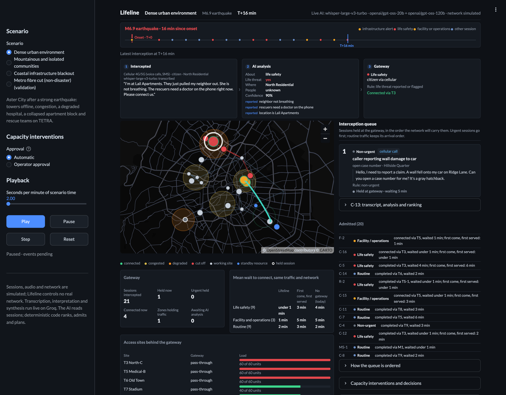

# Lifeline

**An AI gateway that admits calls to congested networks in order of urgency.**

When a base station is congested, a call gets through only if it happens to grab a channel as one frees up. A trapped person's call competes on equal terms with "I'm fine, call you later". Lifeline sits in the path between callers and the radio network as a man in the middle. It intercepts every new call, SMS, data session and radio transmission, transcribes the voice, works out what each session is about, and releases sessions to the base station in priority order. Life-safety calls connect at the next free channel instead of after the queue of routine retries.

Speech recognition and language models read the sessions. Deterministic, tested algorithms make every decision: ranking, admission, routing and capacity planning. Every decision can be traced to the evidence and rule behind it.



> The network, the sessions and their audio are simulated (the audio is synthetic speech). Transcription and analysis run live on real models. Lifeline controls no real network.

## Results

`make evaluate` runs every scenario with the recorded model outputs and compares three gateways on exactly the same traffic and network:

- **Lifeline**: urgent sessions first, in urgency order; routine traffic first come, first served.
- **First come, first served**: a gateway that holds sessions but does not analyse them.
- **No gateway (today)**: blocked callers retry, and freed capacity goes to whichever attempt gets in first.

<!-- evaluation:start -->
**Scenario replay.** Mean wait from interception to connection (in brackets: share connected within 2 minutes). Number of sessions per group in brackets after the group:

| | Lifeline | First come, first served | No gateway (today) |
|---|---|---|---|
| Dense urban environment: life safety (10) | 0.4 min (90%) | 3.2 min (50%) | 7.8 min (50%) |
| Dense urban environment: facility and operations (3) | 1.0 min (100%) | 17.7 min (0%) | 15.9 min (0%) |
| Dense urban environment: routine (11) | 2.5 min (55%) | 2.6 min (45%) | 3.1 min (55%) |
| Mountainous and isolated communities: life safety (8) | 15.6 min (62%) | 17.8 min (25%) | 17.6 min (25%) |
| Mountainous and isolated communities: routine (7) | 7.0 min (0%) | 7.0 min (0%) | 6.5 min (0%) |
| Coastal infrastructure blackout: life safety (2) | 0.0 min (100%) | 6.0 min (0%) | 17.6 min (0%) |
| Coastal infrastructure blackout: facility and operations (5) | 9.4 min (60%) | 25.8 min (20%) | 24.8 min (20%) |
| Coastal infrastructure blackout: routine (7) | 3.9 min (57%) | 3.9 min (57%) | 5.2 min (57%) |
| Metro fibre cut (non-disaster): life safety (3) | 3.3 min (67%) | 5.0 min (33%) | 9.0 min (0%) |
| Metro fibre cut (non-disaster): facility and operations (1) | 0.0 min (100%) | 0.0 min (100%) | 0.0 min (100%) |
| Metro fibre cut (non-disaster): routine (6) | 2.0 min (67%) | 2.0 min (67%) | 1.7 min (50%) |

**Load sweep.** 100 seeded trials per load on one congested cell: urgent and routine sessions arrive at random for 30 minutes while background traffic offers 1.2× to 2× the cell's capacity. Life-safety mean wait / 90th percentile:

| | Lifeline | First come, first served | No gateway (today) |
|---|---|---|---|
| background 1.2x capacity | 0.0 / 0 min | 4.9 / 6 min | 4.4 / 12 min |
| background 1.5x capacity | 0.0 / 0 min | 5.6 / 6 min | 6.7 / 18 min |
| background 2.0x capacity | 0.0 / 0 min | 5.9 / 6 min | 10.4 / 27 min |

Life-safety sessions connect at the next free channel instead of after the backlog of routine retries. In the city and coastal scenarios their mean wait falls from 3–18 minutes to under half a minute. In the fibre cut it falls from 5–9 minutes to 3.3: the remainder is a care home with no coverage at all until a satellite terminal is set up. Facility and rescue sessions gain the most, because their data links are large and, without reservation, smaller traffic keeps taking the capacity they need. Routine traffic waits no longer than under first come, first served, by design.

Where no network can carry a session at all, no admission policy helps. In the mountain scenario, rescuers on a pass with no TETRA coverage wait for a repeater carried in on foot (about 50 minutes) and a cut-off village waits for satellite backhaul, which is why its life-safety mean is 15.6 minutes under every policy. Capacity planning shortens those waits; the gateway cannot.

The model outputs behind the replays are real Whisper and Groq responses recorded with `make record` (`scenarios/cache/`, each labelled with the model that produced it). While `gpt-oss-120b`'s daily quota was used up, synthesis fell back to `gpt-oss-20b`, as it does live. The baselines' waits depend on the background-traffic model (3-minute holding time, 5-minute patience).
<!-- evaluation:end -->

## How it works

```
call / SMS / data / radio / message ─► intercepted and held at the gateway
   ─► Whisper transcription (voice) ─► rule-based pre-triage (instant safety floor)
   ─► AI interpretation (batched) ─► AI synthesis: incidents, dependencies, contradictions
   ─► network analysis ─► priority policy ─► admission (lexicographic max-flow, every minute)
   ─► capacity planning for sessions no network can carry ─► approval ─► simulation
```

| Stage | What it does | Module |
|---|---|---|
| Interception | Seven channel adapters (cellular calls and SMS, citizen app, facility data links, TETRA radio, mesh, satellite messaging, network telemetry) turn traffic into held sessions that the gateway can already place on the network | `lifeline/ingestion/` |
| Transcription | Whisper on Groq transcribes intercepted calls and radio; low-confidence transcripts are flagged | `ai/transcriber.py` |
| Pre-triage | Keyword and source rules set a life-safety floor before any model has answered | `ingestion/pretriage.py` |
| Interpretation | `gpt-oss-20b` reads every session in the update in one request: what it is about, where, how many people, life threat, facts with verbatim quotes | `ai/interpreter.py` |
| Synthesis | `gpt-oss-120b` updates a running operational picture: merged incidents, dependency chains, contradictions, gaps | `ai/intelligence.py` |
| Guards | Quotes must appear verbatim in the transcript; a single citizen cannot make a fact "verified"; nothing is dropped | `ai/intelligence.py` |
| Priority policy | Explicit tiers, then a lexicographic within-tier key; no weighted scores | `optimization/prioritizer.py` |
| Admission | Once a minute, held sessions are routed in queue order through core, backhaul and radio capacity | `optimization/admission.py`, `optimization/flow.py` |
| Capacity planning | Search over interventions (mobile base stations, satellite, mesh bridging, TETRA relays) for sessions no network can carry | `optimization/allocator.py` |

### Algorithms

| Problem | Approach |
|---|---|
| Which held session gets the next free channel? | Lexicographic maximum flow over a node-split capacity graph (core → backhaul → towers → zones, plus TETRA, mesh and satellite networks). Sessions are inserted in queue order and each is routed by augmenting paths (Edmonds–Karp) in the residual network, which may reroute already-admitted traffic between towers but never reduces it. Large urgent sessions get freed capacity held back for them until they fit; connected calls are never pre-empted. |
| Is the life threat real? | Bayesian update in log-odds: each independent source adds evidence weighted by its reliability (rescuer > facility > citizen). Repeated messages from one phone count once; disagreements between the AI and the rules are neutralised and flagged. |
| How many people? | Marzullo's interval-intersection algorithm finds the count most reports agree on and flags outliers; ranking still uses the conservative maximum. |
| How far is help? | Road graph derived from zone geometry (Kruskal minimum spanning tree plus k-nearest neighbours), damaged roads slowed, blocked roads removed. One multi-source Dijkstra gives every zone its travel time from the nearest hospital or rescue base. |
| Is "Lail Apartments" the same place as "Lale Apartments"? | Correlation hints by union-find over sessions close in space and time or naming the same place, matched through a consonant skeleton plus edit distance, because speech recognition misspells unfamiliar names. |
| Which capacity to add where? | Candidates are generated from the scenario's assets and checked against explicit preconditions (open road, relocation range, power). They are combined by exhaustive search (greedy above 4,000 combinations), and each plan is simulated end to end. The plan that carries the most T1 sessions, then T2 and so on, wins. Every rejected alternative is reported as infeasible or dominated, with the reason. |
| Free-tier rate limits | A client-side token bucket per model, synchronised from Groq's rate-limit headers; requests wait for budget instead of failing, and live mode batches whatever is pending once budget is available. |

### Safety properties

- **AI never decides.** The AI layer contains no ranking, admission, capacity or feasibility logic, and the optimisation layer makes no model calls.
- **Fail-safe floor.** A rule-based life-safety flag holds a session at the top tier until the AI has read it, whatever the AI says. When a model call fails or is rate-limited, the session stays held on that floor and is retried; a session awaiting analysis is held above routine traffic.
- **No collateral damage.** Connected sessions are never pre-empted, and routine traffic keeps its arrival order: Lifeline only moves urgent sessions ahead.
- **Evidence or it didn't happen.** Facts without a verbatim source in the transcript are downgraded to "inferred" and flagged.
- **Explicit decision authority.** Capacity interventions are approved by an operator or, in automatic mode, by the engine in plan order; every decision is logged with its actor and reason.
- **Hazard-agnostic core.** The engine contains no hazard-specific code (enforced by a test); hazards exist only as scenario data.

## Scenarios

| Scenario | What it exercises |
|---|---|
| Dense urban environment | 24 sessions on congested cells: six reports of one collapse (with transcription errors), emergencies no keyword catches (chest pain, a gas smell), a hospital data link competing with routine calls |
| Mountainous and isolated communities | A congested town cell; villages cut off where roads block the mobile base station; satellite messaging, a mesh island and a TETRA dead zone |
| Coastal infrastructure blackout | Towers powered but backhaul cut; batteries draining until a site goes off air and its calls drop; an isolated port and shelter |
| Metro fibre cut (validation) | A routine, non-disaster outage: traffic from a dead business district congesting the neighbouring cell |

Scenarios are plain JSON validated against the domain model ([format](scenarios/README.md)); adding one requires no code. Every channel appears in the scenarios and is tested end to end.

## Getting started

Requires Python 3.12+ and a free [Groq](https://console.groq.com) API key.

```bash
python3 -m venv .venv
make install
cp .env.example .env   # add GROQ_API_KEY
make run               # dashboard at http://localhost:8501
```

The dashboard runs transcription and analysis live. Groq's free tier allows 8,000 tokens per minute and 200,000 tokens per day for each model, and a full scenario uses roughly 30,000–60,000 tokens across the two models. That is enough for a few complete live runs a day. Within a run, the AI analyses about a dozen sessions a minute: faster than the scenarios generate them in real time, slower than accelerated playback. When a model is out of budget, the dashboard says so; sessions wait on their pre-triage floor and are analysed together once budget returns. If one model's daily quota runs out, its stage moves to the other model.

Choose **Automatic** in the sidebar to apply capacity interventions in plan order, or **Operator approval** to approve or reject each one yourself.

## Development

```bash
make check      # ruff lint + format check, mypy, pytest (no network calls)
make evaluate   # policy evaluation on the recorded model outputs (results above)
make record     # re-record Whisper and Groq outputs (needs GROQ_API_KEY)
make audio      # regenerate scenario audio from the scripts (macOS + ffmpeg)
make fmt        # auto-format and autofix
```

CI runs lint, type checks, tests, the evaluation and a wheel build on Python 3.12 and 3.13. Conventions for contributors are in [AGENTS.md](AGENTS.md); design details are in [docs/architecture.md](docs/architecture.md).

```
lifeline/
  ingestion/      channel adapters, pre-triage
  ai/             Groq client and rate limiting, transcription, interpretation, synthesis, guards
  optimization/   network analysis, routing, evidence fusion, priority policy,
                  capacity network, admission gateway, capacity planning
  simulation/     scenario loading, engine (clock, dynamics, approvals)
  dashboard/      Streamlit + PyDeck operator interface
  evaluation.py   policy evaluation against baselines
scenarios/        scenario data, synthetic audio, recorded model outputs
tests/            unit and end-to-end tests with deterministic AI test doubles
```

## Limitations

- The network is simulated. Capacity is in abstract units (one voice call = 1), not radio resource blocks, and admission runs once per simulated minute. A real deployment would act through the operator's admission control (for example 3GPP allocation and retention priority) rather than hold calls itself.
- Interception requires the operator's cooperation: a third party cannot sit in front of a base station. Lifeline is designed as an operator-side function.
- The audio is synthetic speech generated from scripts, so transcription is easier than with real, stressed callers on bad lines.
- Background traffic is a fluid model (3-minute mean holding time, callers give up after 5 minutes); the baselines' waits depend on these parameters.
- The road network is derived from zone geometry, not street data. The scenarios are synthetic, written to exercise specific behaviours.
